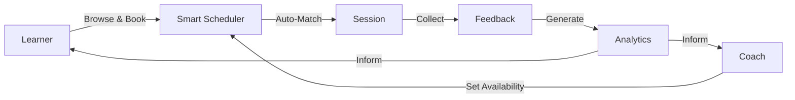
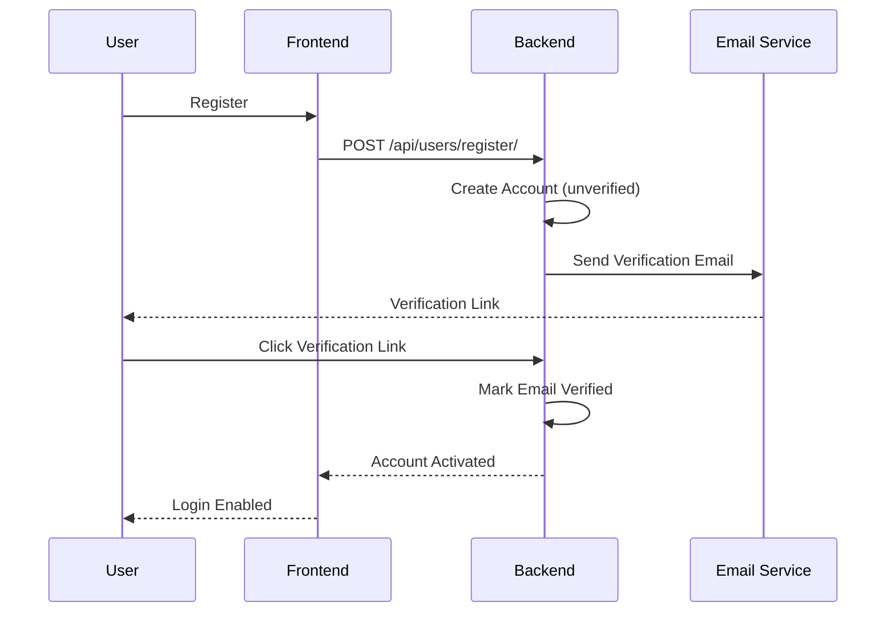

# Cohortiva

> A comprehensive coaching session management platform designed to streamline the connection between learners and coaches, featuring real-time scheduling, feedback collection, and performance analytics.

[](https://cohortiva.vercel.app)
[](https://github.com/rakinmohammedrafeeq/cohortiva)
[](https://github.com/rakinmohammedrafeeq/cohortiva)

---

## Table of Contents

- [Overview](#overview)
- [Why Cohortiva?](#why-cohortiva)
- [Key Features](#key-features)
- [Architecture](#architecture)
- [Getting Started](#getting-started)
- [Documentation](#documentation)
- [Technology Stack](#technology-stack)
- [Deployment](#deployment)
- [Contributing](#contributing)
- [License](#license)

---

## Overview

Cohortiva is a modern web application that bridges the gap between learners seeking guidance and coaches offering expertise. The platform eliminates the friction in traditional coaching systems by providing:

- **Automated scheduling** based on coach availability
- **Secure authentication** with email verification
- **Real-time session management** with status tracking
- **Feedback loops** for continuous improvement
- **Performance analytics** for coaches and administrators

### The Problem

Traditional coaching systems suffer from:
- Manual scheduling conflicts and double-bookings
- Lack of centralized feedback collection
- No visibility into session history or performance metrics
- Complex registration workflows for both coaches and learners
- Poor mobile experience and outdated interfaces

### The Solution

Cohortiva solves these challenges through:



The platform automates scheduling by matching learner requests with coach availability windows, eliminating back-and-forth communication. All session data flows into analytics dashboards that help coaches improve and learners make informed choices.

---

## Why Cohortiva?

### For Learners
- **One-click booking** from available time slots
- **Transparent coach profiles** with expertise and feedback ratings
- **Session history** and progress tracking
- **Mobile-responsive** interface for booking on-the-go

### For Coaches
- **Flexible availability management** with recurring schedules
- **Automated session confirmations** and reminders
- **Feedback insights** to improve coaching quality
- **Performance reports** showing booking trends and ratings

### For Administrators
- **Coach application workflow** with approval system
- **Platform-wide analytics** across all sessions
- **User management** with role-based access control
- **Audit trails** for compliance and debugging

---

## Key Features

### 🔐 Secure Authentication
- Email-based registration with anti-enumeration protection
- JWT token authentication with automatic refresh
- Password reset with time-limited tokens
- Role-based access control (Learner, Coach, Admin)



### 📅 Smart Scheduling
- Coaches define availability windows by day of week
- Learners see only available slots (no conflicts)
- Automatic timezone handling
- Past-date validation to prevent booking errors
- Online and offline session modes

### 📊 Feedback & Analytics
- Post-session rating system (1-5 stars)
- Text feedback collection
- Aggregated performance reports by date range
- Session history with filter and search capabilities

### 🎓 Coach Application System
- Public application form for aspiring coaches
- Admin review dashboard with approve/reject actions
- Automatic role elevation upon approval
- Rejection reason tracking

---

## Architecture

Cohortiva follows a modern three-tier architecture with clear separation of concerns:

```mermaid
graph TB
    subgraph "Frontend - React SPA"
        A[React Router]
        B[Axios HTTP Client]
        C[JWT Token Management]
        D[Dashboard Views]
    end
    
    subgraph "Backend - Django REST API"
        E[DRF Endpoints]
        F[JWT Authentication]
        G[Business Logic]
        H[ORM Models]
    end
    
    subgraph "Data Layer"
        I[PostgreSQL - Neon]
        J[Email Service - Resend]
    end
    
    A --> D
    D --> B
    B --> C
    C --> E
    E --> F
    F --> G
    G --> H
    H --> I
    G --> J
    
    style A fill:#61DAFB
    style E fill:#092E20
    style I fill:#336791
```



### Frontend Architecture
- **React 19** with functional components and hooks
- **React Router 7** for client-side navigation
- **Axios** with interceptors for auth token injection
- **Modular dashboard** with lazy-loaded sections

### Backend Architecture
- **Django 5.2** with Django REST Framework 3.16
- **PostgreSQL** via Neon serverless database
- **JWT authentication** with token blacklist on password reset
- **django-anymail** for transactional email via Resend

### Security Features
- **Anti-enumeration** protection on public endpoints
- **Rate limiting** (IP-based and per-account cooldowns)
- **HTTPS enforcement** in production
- **CORS configuration** for cross-origin requests
- **Password validation** enforcing complexity rules
- **Token invalidation** after password changes

---

## Getting Started

### Prerequisites
- **Python 3.11+** and pip
- **Node.js 18+** and npm
- **PostgreSQL** (or use Neon free tier)
- **Git** for version control

### Quick Start

#### 1. Clone the Repository
```bash
git clone https://github.com/rakinmohammedrafeeq/cohortiva.git
cd cohortiva
```

#### 2. Backend Setup
```bash
cd app/backend
python -m venv venv
source venv/bin/activate  # On Windows: venv\Scripts\activate
pip install -r requirements.txt

# Create .env file
cp .env.example .env
# Edit .env with your DATABASE_URL and RESEND_API_KEY

# Run migrations
python manage.py migrate

# Create superuser
python manage.py createsuperuser

# Start development server
python manage.py runserver
```

#### 3. Frontend Setup
```bash
cd ../frontend
npm install

# Start development server
npm start
```

#### 4. Access the Application
- **Frontend**: http://localhost:3000
- **Backend API**: http://localhost:8000/api
- **Admin Panel**: http://localhost:8000/admin

---

## Documentation

Comprehensive guides are available in the `/docs` folder:

### Getting Started
- [Installation Guide](docs/INSTALLATION.md) - Detailed setup instructions
- [Environment Variables](docs/ENVIRONMENT.md) - Configuration reference
- [Database Setup](docs/DATABASE.md) - PostgreSQL and migrations

### Features
- [Authentication Flow](docs/AUTH_FLOW.md) - Registration, login, and verification
- [Scheduling System](docs/SCHEDULING.md) - How availability matching works
- [Feedback System](docs/FEEDBACK.md) - Rating collection and analytics

### API Reference
- [API Endpoints](docs/API.md) - Complete REST API documentation
- [Authentication](docs/API_AUTH.md) - JWT token usage
- [Error Handling](docs/API_ERRORS.md) - Status codes and error responses

### Architecture
- [System Design](docs/ARCHITECTURE.md) - High-level system overview
- [Database Schema](docs/DATABASE_SCHEMA.md) - Entity relationships
- [Security](docs/SECURITY.md) - Authentication, authorization, and data protection

### Deployment
- [Production Deployment](docs/DEPLOYMENT.md) - Render + Vercel setup
- [Environment Configuration](docs/PRODUCTION_CONFIG.md) - Production environment variables
- [Monitoring](docs/MONITORING.md) - Logging and error tracking

---

## Technology Stack

### Frontend
| Technology | Version | Purpose |
|------------|---------|---------|
| React | 19.0.0 | UI framework |
| React Router | 7.9.3 | Client-side routing |
| Axios | 1.12.2 | HTTP client |
| CSS3 | - | Styling (no framework dependencies) |

### Backend
| Technology | Version | Purpose |
|------------|---------|---------|
| Django | 5.2.7 | Web framework |
| Django REST Framework | 3.16.1 | API framework |
| PostgreSQL | 16+ | Primary database |
| django-anymail | 11.1 | Email integration |
| django-ratelimit | 4.1.0 | Rate limiting |
| djangorestframework-simplejwt | 5.5.1 | JWT authentication |

### Infrastructure
| Service | Purpose |
|---------|---------|
| [Neon](https://neon.tech) | Serverless PostgreSQL hosting |
| [Render](https://render.com) | Backend hosting (Django) |
| [Vercel](https://vercel.com) | Frontend hosting (React SPA) |
| [Resend](https://resend.com) | Transactional email delivery |

---

## Deployment

Cohortiva is deployed as a distributed application:

```mermaid
graph LR
    A[User Browser] -->|HTTPS| B[Vercel CDN]
    B -->|React SPA| C[Frontend]
    C -->|API Calls| D[Render Backend]
    D -->|PostgreSQL| E[Neon Database]
    D -->|Email API| F[Resend]
    
    style B fill:#000
    style D fill:#4A5568
    style E fill:#336791
    style F fill:#10B981
```



### Production URLs
- **Frontend**: https://cohortiva.vercel.app
- **Backend API**: https://cohortiva-backend.onrender.com/api

### Deployment Steps

#### Backend (Render)
1. Connect GitHub repository to Render
2. Set environment variables (see [DEPLOYMENT.md](docs/DEPLOYMENT.md))
3. Configure build command: `pip install -r requirements.txt`
4. Set start command: `gunicorn Backend.wsgi:application`

#### Frontend (Vercel)
1. Connect GitHub repository to Vercel
2. Set root directory to `app/frontend`
3. Build command: `npm run build`
4. Output directory: `build`

Detailed deployment instructions with environment variable templates are available in [docs/DEPLOYMENT.md](docs/DEPLOYMENT.md).

---

## Contributing

Contributions are welcome! Please follow these guidelines:

### Development Workflow
1. Fork the repository
2. Create a feature branch (`git checkout -b feature/amazing-feature`)
3. Make your changes
4. Run tests (`python manage.py test` for backend)
5. Commit with descriptive messages
6. Push to your fork
7. Open a Pull Request

### Code Standards
- **Python**: Follow PEP 8, use type hints where appropriate
- **JavaScript**: Follow Airbnb style guide, use ESLint
- **Commits**: Use conventional commit messages (`feat:`, `fix:`, `docs:`, etc.)
- **Documentation**: Update relevant docs when changing functionality

### Testing
- Write unit tests for new backend features
- Ensure all existing tests pass before submitting PR
- Test UI changes across Chrome, Firefox, and Safari

---

## License

This project is licensed under the MIT License - see the [LICENSE](LICENSE) file for details.

---

## Acknowledgments

- Built with ❤️ for learners and coaches worldwide
- Special thanks to the open-source community
- Inspired by the need for better coaching tools in education

---

**Questions?** Open an issue or contact the maintainer.

**Found a bug?** Please report it with steps to reproduce.

**Want a feature?** Create a feature request with use cases.
